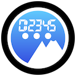

# `RVT` (Rift Valley Timer)

[Code documentation for the main app, Watch app, and Watch complication](https://riftvalleysoftware.github.io/ambiamara/)

## OVERVIEW

This repository contains RVT **4.0.0 (build 0019)** for iPhone and iPad, with the RVT Remote companion app for Apple Watch.

iPhone and iPad require iOS 17 or iPadOS 17 or later. The companion app requires watchOS 10 or later.

### WHAT’S NEW IN 4.0

- Use **Combine Timers** to display a timer group as one countdown. In the timer editor, use **Start in Warning** or **Start in Final** to choose the starting phase.
- Use RVT Remote to control the timer on a paired iPhone or nearby iPad. The Apple Watch complication shows the remaining time and marks the warning and final phases.
- Open **About This App** to export or restore a `.rvtbackup` file. Restoring a backup replaces the current timers and settings.
- Find dependency credits and the app source link under **RVT** in the system Settings app.
- The app supports English, French, German, Italian, Brazilian Portuguese, and European Spanish.

## BASIC ARCHITECTURE

### [THE MODEL](https://github.com/RiftValleySoftware/ambiamara/tree/master/Sources/Shared/Sources/Model)

The core of the app, is the [``TimerEngine``](https://github.com/RiftValleySoftware/ambiamara/blob/master/Sources/Shared/Sources/Model/TimerEngine.swift) class. This provides the basic timer operation and control. Its domain is just the "ticker," for a single timer. It doesn't define a lot of the app behavior.

Wrapping that, is the [``TimerModel``](https://github.com/RiftValleySoftware/ambiamara/blob/master/Sources/Shared/Sources/Model/TimerModel.swift) class, which adds app behavior to the engine, like multiple timers, and timer groups. Most of the app behavior comes from this class.

The main app owns the timer engine, group selection, and alarms. `RiValT_WatchDelegate` sends the selected timer’s state, available controls, and countdown deadline to the Watch. The Watch uses the deadline to display the remaining time between updates. The main app applies commands and reports the result, including any change to the active timer.

### THE TARGETS

#### [The Main App Target](https://github.com/RiftValleySoftware/ambiamara/tree/master/Sources/MainApp)

The `RVT` target uses Apple’s [`UIKit`](https://developer.apple.com/documentation/uikit) framework to build the iPhone and iPad app.

#### The [Watch App](https://github.com/RiftValleySoftware/ambiamara/tree/master/Sources/WatchApp) and [Watch Complication](https://github.com/RiftValleySoftware/ambiamara/tree/master/Sources/WatchComplications) Targets

RVT Remote is a SwiftUI companion embedded in the iOS app. It connects to the paired iPhone through WatchConnectivity. To control an iPad, turn on **Watch Remote** in RVT’s settings on iPad. On the Watch, open **Timer device**, choose **Find nearby iPads**, and select a nearby RVT device. When the pairing codes on the Watch and this iPad match, tap **Allow** on the iPad. Close settings and keep RVT in the foreground on the device running the timer. The Watch app embeds the WidgetKit complication extension.

#### [The Test Targets](https://github.com/RiftValleySoftware/ambiamara/tree/master/Tests)

There is one target, implementing [a SwiftUI test harness for the ``TimerEngine``](https://github.com/RiftValleySoftware/ambiamara/tree/master/Tests/TimerEngineTestHarness), and two targets, devoted to unit testing the [``TimerEngine``](https://github.com/RiftValleySoftware/ambiamara/tree/master/Tests/TimerEngineTests) and [``TimerModel``](https://github.com/RiftValleySoftware/ambiamara/tree/master/Tests/TimerModelTests). These are only used for testing. The unit tests are not "complete" (providing 100% code coverage), but they do test the crucial functionality of each model subsystem.

## LICENSE

> NOTE: The app code is not licensed for re-use!
> It is "source-available," **NOT** open-source! It does, however, depend on several true, open-source packages (listed below).
> We are not soliciting pull requests or patches. However, if you have a request or an issue, [feel free to contact us.](https://riftvalleysoftware.com/contact)

## DEPENDENCIES

This project depends upon:

- [RVS Basic GCD Timer](https://github.com/RiftValleySoftware/RVS_BasicGCDTimer)
- [RVS Checkbox](https://github.com/RiftValleySoftware/RVS_Checkbox)
- [RVS Generic Swift Toolbox](https://github.com/RiftValleySoftware/RVS_Generic_Swift_Toolbox)
- [RVS Persistent Prefs](https://github.com/RiftValleySoftware/RVS_PersistentPrefs)
- [RVS Retro LED Display](https://github.com/RiftValleySoftware/RVS_RetroLEDDisplay)
- [RVS UIKit Toolbox](https://github.com/RiftValleySoftware/RVS_UIKit_Toolbox)

It also uses the [Let's Go Digital](https://fonts2u.com/lets-go-digital-regular.font) font, by [Wolf Lambert](https://fonts2u.com/font-designers/wolf-lambert.html)
 
## MORE INFORMATION:

For more complete instructions, and information about authorship, support, and privacy, visit https://riftvalleysoftware.com/the-rift-valley-timer/
